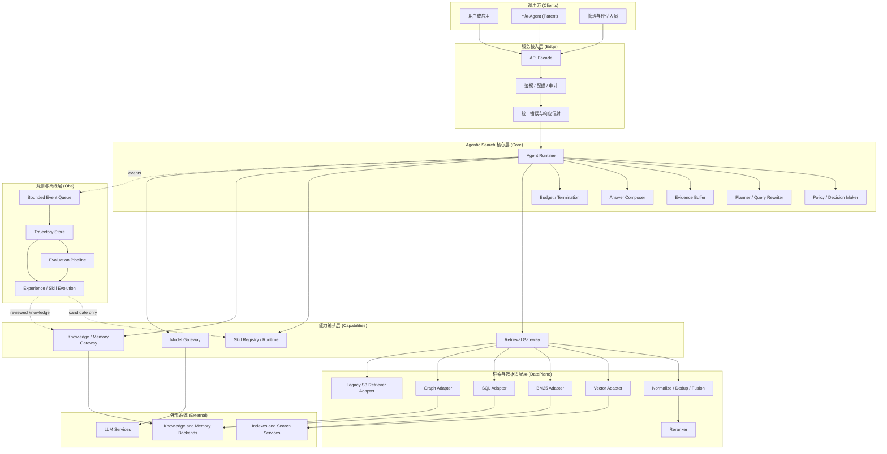

# AgenticSearch 平台设计文档（v2.1 · 不含 RL）

> 版本：v2.1｜v2.1 变更：总体架构对齐权威架构图（§4.1）——七层结构（调用方/服务接入/核心/能力编排/检索与数据适配/观测与离线/外部系统）；核心层细化为 Agent Runtime 六组件；新增四网关与 Bounded Event Queue 旁路观测；进化产物改为「候选+审核」制（candidate only / reviewed knowledge）
> 版本历史：v1.0 初稿；v1.1 知识记忆库对接收敛为 CRUD 四类接口（Agent 工具化 + 内部更新机制直插）；v2.0 结构化重组（四部分交付结构）；v2.1 按权威架构图对齐重构（本版）
> 范围：基于现有 s3 / AgenticSearch 代码仓演进，**v1 阶段不包含 RL 训练**，但保留与 RL（verl）的接口兼容性，便于 v2 平滑接入。
> 阅读对象：架构、算法、后端工程师。

**文档导读**：

- **第一部分（§1–§3）系统定位与核心设计**：为什么做、做什么、核心设计思想（原则/概念/决策）——评审入口；
- **第二部分（§4–§5）系统总体架构**：以 §4.1 权威架构图为纲（七层结构），展开模块职责、项目结构、关键数据流、运行与部署；
- **第三部分（§6–§10）详细设计**：数据模型、知识记忆库 CRUD 接口、对外接口、轨迹存储、自进化 Skill 与索引；
- **第四部分（§11–§14）视图与落地**：4+1 视图、迁移路线、里程碑验收、附录。

---

# 第一部分：系统定位与核心设计

## 1. 背景与问题定义

### 1.1 现状：s3 智能体搜索框架

现有代码仓（s3）是一个面向检索增强生成的搜索智能体框架，核心是"搜索助手（Search Copilot）"：模型输出 `<query>` / `<search_complete>` 等结构化动作，外部检索服务返回 `<information>` 观测，循环多轮直至给出答案。当前实现围绕 verl + PPO 的 RL 训练闭环（`verl/trainer/ppo/ray_trainer.py` 调用 `s3/llm_agent/generation_s3.py`），训练与推理共享同一套循环代码。

### 1.2 现状代码盘点（与设计的映射基础）

| 现有代码 | 作用 | 设计中的去向 |
|---|---|---|
| `s3/llm_agent/generation_s3.py` | Search-C1 智能体循环（RL 训练用），含 `run_llm_loop`、`execute_predictions`、`postprocess_predictions`、`batch_search` | 拆解为 `agent/runtime`（循环骨架）+ `agent/policies`（决策）+ `agent/planner`（改写）+ `agent/actions`（动作解析），v1 复用其动作协议 |
| `s3/llm_agent/generation_searchr1.py` | Search-R1 风格循环（观测/奖励与 s3 略有差异） | 同一动作协议下的另一个循环策略实现，v1 保留兼容 |
| `s3/llm_agent/tensor_helper.py` | 张量拼接/掩码工具（RL 专用） | 移入 `agent/runtime/rl/` 适配层（v2），v1 不依赖 |
| `s3/search/retrieval_server.py` | FastAPI 检索服务 `POST /retrieve`（BM25 / Dense faiss，支持远程 embedding API） | 过渡期经 `retrieval/backends/legacy_s3.py`（Legacy S3 Retriever Adapter）包装复用，长期演化为 `retrieval/server.py` + `retrieval/backends/*` |
| `s3/search/retrieval.py` | 检索逻辑（可导入的库形式） | `retrieval/backends/dense.py` / `bm25.py` |
| `s3/search/serp_search_server.py` | 在线搜索（SERP）`POST /retrieve` | `retrieval/backends/serp.py`，统一到同一检索接口 |
| `s3/search/rerank_server.py`、`retrieval_rerank_server.py` | 重排服务 | `retrieval/rerank.py` |
| `s3/search/index_builder.py` | faiss 索引构建 | 保留于 `scripts/index_build/` |
| `generator_llms/*` | 生成器 LLM 适配器（qwen / gpt-azure / claude / together / deepinfra / local vLLM） | 保留为 Model Gateway 的 provider 适配（`gateways/model_gateway.py` 统一接入、重试降级） |
| `scripts/data_process/*`、`scripts/dataset_construct/*` | 数据构造（parquet，含 `<question>` 模板） | 保留；新增轨迹数据生成入口 |
| `scripts/baselines/*` | RAG / DeepRetrieval / IRCoT / Search-o1 / Search-R1 基线 | 保留评估对比；v1 智能体可作为统一替代 |
| `scripts/evaluation/*` | 评估（context、zeroshot、eval_only） | 保留，并新增轨迹级评估组件 |
| `verl/*` | RL 训练框架（PPO） | **v1 不启用**；`agent/runtime/rl/` 预留适配接口，动作协议保持兼容 |
| `utils/embedding_client.py` | OpenAI 兼容 embedding API 客户端 | 保留，供知识层（图谱实体/向量/轨迹摘要）向量化复用 |
| `data/agentic/` | agentic 数据样例（s3_api_results.json 等） | 作为轨迹数据的雏形，转为标准轨迹格式 |

### 1.3 核心问题定义

| # | 问题 | 现状表现 |
|---|---|---|
| P1 | 循环与训练耦合 | 智能体循环嵌在 RL 训练框架（verl）内，无法作为独立推理服务部署与复用 |
| P2 | 知识不沉淀 | 只有语料检索（BM25/Dense），无知识记忆层：跨会话经验、结构化知识、图谱关系无法写入与复用 |
| P3 | 经验不可追溯 | 搜索过程不落盘：无法回放一次搜索的完整决策过程，无法诊断失败，无法复用成功经验 |
| P4 | 策略不自进化 | 决策质量改进依赖人工迭代提示词与检索参数，无系统化的"归纳→验证→发布"机制 |
| P5 | 接口不完整 | 对外仅 `/retrieve` 检索接口，缺智能体、轨迹、知识、技能等服务化接口 |

**v1 的使命**：在不动 RL（verl）的前提下，把这套搜索智能体演进为一个"可服务化、可沉淀、可自进化"的平台，并为 v2 的 RL 训练保留数据与接口兼容。

---

## 2. 系统定位

### 2.1 定位陈述

> **AgenticSearch 是一个可沉淀、可进化的智能体搜索平台**：以兼容 s3 动作协议的搜索智能体为核心，把每一次搜索产生的**轨迹、知识、经验**沉淀为平台资产（知识记忆库 / 轨迹库 / Skill 库），并通过**离线自进化闭环**持续改进检索与决策质量。

三个关键词（分别回应 §1.3 的问题）：

- **服务化**（P1/P5）：智能体循环脱离训练框架，成为可独立部署、可水平扩展的推理服务；
- **资产化**（P2/P3）：轨迹、知识、经验全部落库，成为可查询、可复用、可训练的数据资产；
- **自进化**（P4）：非梯度式（统计归纳 + LLM 提炼 + A/B 验证）的持续改进闭环，RL 留给 v2。

### 2.2 目标用户与核心场景

| 用户 | 场景 | 使用入口 |
|---|---|---|
| 算法/评测工程师 | 多跳问答评测、基线对比、批量实验 | `/v1/agent/tasks` + 轨迹评估回填 |
| 应用开发者 | 把智能体搜索嵌入自有产品（客服、研究助手） | `/v1/agent/search` + `/retrieve` |
| 平台算法工程师 | 知识库运营（导入/聚合/溯源）、Skill 进化运营 | Ingestor 脚本 + `/v1/skills` |
| v2 训练（预留） | 用轨迹数据训练 RL 搜索策略 | 轨迹导出（parquet 兼容，§9.4） |

### 2.3 与周边方案的关系

| 方案 | 差异 |
|---|---|
| 朴素 RAG（单次检索 + 生成） | AgenticSearch 是多轮循环决策，检索是"动作"而非固定流程；且检索质量与搜索经验可沉淀、可进化 |
| 通用 Agent 框架（LangChain / LangGraph 等） | 本平台面向"搜索"垂直域：动作协议与检索栈深度绑定；轨迹格式面向搜索评估/训练定制；自带非梯度自进化闭环 |
| s3 / verl（RL 训练框架） | 本平台 v1 = s3 的服务化演进，**不含训练**；动作协议与数据格式保持兼容，v2 可回接 verl 训练 |

### 2.4 范围与非目标

**范围内（v1）**：智能体推理服务；知识记忆库 CRUD 对接（多后端）；轨迹存储与语义检索；离线 Skill 自进化；三层自进化索引；对外 REST API。

**非目标（v1）**：RL/策略梯度训练（v2，`agent/runtime/rl/` 预留）；在线重建倒排/向量索引（离线构建 + 热桶增量留 v2）；多智能体协作编排；图形界面。

---

## 3. 核心设计

### 3.1 设计原则（后续章节的设计依据）

| # | 原则 | 含义 | 主要落点 |
|---|---|---|---|
| D1 | 协议兼容优先 | `<query>`/`<search_complete>`/`<information>` 动作协议与 `/retrieve` 签名不变，存量调用方零破坏 | §8.1、§12 |
| D2 | 读写分离 | 知识"读"对 Agent 开放为工具；"写"统一收口内部 Ingestor（受控 add 工具除外）；对外不暴露写 API | §7.2/§7.3 |
| D3 | 一切皆轨迹 | 每轮动作/观测/决策/耗时全量落盘，评估、进化、诊断、训练共用同一数据底座 | §9 |
| D4 | 进化非梯度 | v1 用"统计归纳 + LLM 提炼 + A/B 验证"替代 RL 获得持续改进，可解释、可回滚 | §10 |
| D5 | 稳定索引 + 活参数 | 索引本体离线构建保稳定；在线只进化参数（重排/融合/改写）与图谱活索引 | §10.6 |
| D6 | 可插拔后端 | 知识与轨迹存储统一 Protocol，多后端（图谱/向量/SQL/BM25/记忆）可替换、可组合 | §7.4、§9.2 |

### 3.2 核心概念模型

五个核心概念（可序列化的数据模型见 §6）：

| 概念 | 一句话定义 |
|---|---|
| **Agent Runtime** | 核心层循环中枢：Planner 改写查询、Policy 每轮决策动作（search / knowledge_query / answer…），经四网关执行产生观测，Evidence Buffer 维护证据，Budget 控制终止 |
| **KnowledgeBase** | 知识记忆库：多后端统一 CRUD 协议的读写层，"读"服务检索增强，"写"沉淀平台经验 |
| **Trajectory** | 一次搜索的完整记录（turns 全量），是评估、进化、诊断、训练的统一数据底座 |
| **Skill** | 可复用的搜索经验单元（触发条件 + 执行体 + 统计），由离线进化管线生产与淘汰 |
| **三层索引** | 基础索引（离线，稳）+ 经验层参数（在线自适应）+ 图谱活索引（随轨迹进化） |

概念关系：

```
在线主链路:
  question → Agent Runtime ──(Planner 改写 / Policy 决策)──→ Action
                 │                        │ 经四网关执行（Retrieval / Knowledge / Skill / Model Gateway）
                 │                        ▼
                 │            Observation → Evidence Buffer → … → Answer Composer → answer
                 │ events（旁路）
                 ▼
        Bounded Event Queue → Trajectory（轨迹库）

离线进化闭环（全部"审后生效"）:
  Trajectory ──评估──→ 归纳/聚类 ──LLM 提炼──→ 候选产物
      │                                        ├─ candidate only ──→ Skill Registry（审核后 active）─→ 反哺 Policy
      │                                        └─ reviewed knowledge ─→ Knowledge Gateway（审核后写入）
      └── 轨迹沉淀（经 Knowledge Gateway → Ingestor：实体/关系/经验片段）──→ KnowledgeBase（图谱活索引）
```

### 3.3 关键设计决策

| 决策点 | 选择 | 理由 | 被否方案 |
|---|---|---|---|
| 知识库交互 | CRUD 四接口收敛（query/add/update/delete + batch_upsert） | 语义最小完备，Agent 工具化与内部更新机制共用一套契约 | 读/写/事件三类接口（事件流引入时序耦合，v1 无消费者） |
| 知识写入路径 | 对外不暴露写 API，统一走 Ingestor（Agent 的 add 工具受控开启） | 保证可追溯（source）与幂等，防知识污染 | 开放写 API（溯源与质量不可控） |
| 进化方式 | 离线非梯度（归纳 + 提炼 + A/B） | 无训练基础设施依赖；可解释、可回滚；v1 即可跑通闭环 | RL（依赖 verl 训练栈，v2）；在线即时进化（无验证闸门，风险高） |
| 索引进化 | 三层：离线基础 + 在线参数 + 图谱活索引 | 兼顾稳定性（运行期索引只读）与进化性（参数与图谱可变） | 在线重建索引（延迟/一致性风险）；纯静态索引（无进化能力） |
| 循环运行形态 | 独立推理服务（FastAPI），无 verl 依赖 | 服务化复用；RL 只是 v2 的一种 loop 实现 | 继续嵌在训练框架内 |
| 轨迹存储 | JSONL + SQLite 元数据 + faiss 语义索引 | 零依赖起步、可回放、可语义召回、可转 parquet 训练格式 | 单一数据库（大文本检索弱）；纯日志文件（不可查询） |
| 运行时与观测解耦 | 领域事件 + Bounded Event Queue（有界、可降级） | 轨迹/审计零阻塞在线链路；队列满丢明细保摘要，不反压主循环 | 同步逐轮写库（阻塞在线路径）；无界队列（内存失控） |
| 进化产物生效方式 | 候选 + 审核制（Skill：candidate only；知识：reviewed knowledge） | 进化不能直接改线上行为；可解释、可回滚、防知识污染 | 进化产物自动激活（无验证/审核闸门，风险高） |
| 能力接入方式 | 四网关编排（Retrieval / Skill / Knowledge / Model Gateway） | Runtime 只认网关：能力可替换、可开关、可审计 | Runtime 直连各后端（耦合扩散、难治理） |

### 3.4 v1 设计目标

**v1 设计目标**（不依赖 RL）：

1. 把"智能体循环"从 RL 训练代码中解耦，成为可独立运行的推理服务；
2. 支持**知识记忆库对接层**：以增删改查（CRUD）四类接口对接多种知识后端（知识图谱、向量库、SQL、BM25、短期记忆）；Agent 将 CRUD 当工具调用，自进化总结知识/多条记忆经内部更新机制直接插入；
3. 支持**轨迹存储（Trajectory Storage）**：Runtime 每步动作、观测、决策与评估以领域事件经 Bounded Event Queue 旁路落库（不阻塞在线链路），可回放、可检索；
4. 支持**自进化 Skill**：从成功/失败轨迹中归纳、提炼、验证，产物以「候选（candidate）+ 审核」方式发布，形成离线自进化闭环（非梯度式进化）；
5. 定义清晰的**对外接口**（检索、智能体、轨迹、Skill、健康检查），与现状代码保持动作协议兼容；
6. 支持**自进化索引（三层策略）**：基础索引离线批量构建保质量，经验层做轻量自适应（重排权重/融合系数/改写规则），图谱作为"活索引"随轨迹进化（§10.6）。

---

# 第二部分：系统总体架构

## 4. 总体架构

### 4.1 架构总览（权威架构图）

系统由七个子系统/层次组成：**调用方 → 服务接入层（Edge）→ Agentic Search 核心层（Core）→ 能力编排层（Capabilities）→ 检索与数据适配层（DataPlane）**构成在线主链路；**观测与离线层（Obs）**以事件旁路挂在核心层；**外部系统（External）**在最外圈被网关与适配层对接。下图为本平台的**权威架构图**，后续所有设计（模块、目录、数据流、视图）均以此图为准：



分层职责与设计原则（§3.1）的对应：

| 层 | 组件 | 职责 | 原则落点 |
|---|---|---|---|
| 调用方 | 用户或应用 / 上层 Agent / 管理与评估人员 | 三类调用方：终端问答与嵌入（应用）、程序化编排（Parent Agent 把本平台当子智能体调用）、运营评估（轨迹/Skill/知识管理） | — |
| 服务接入层（Edge） | API Facade → 鉴权/配额/审计 → 统一信封 | 唯一入口：请求先过鉴权（`X-Api-Key`、配额限流、审计日志），再套统一响应/错误信封 `{code, data, message}`，然后进入 Runtime | D1 协议兼容（`/retrieve` 原样透传）在此层落地 |
| 核心层（Core） | Agent Runtime + Policy / Planner / Evidence Buffer / Answer Composer / Budget | 搜索循环中枢：Runtime 驱动循环；Policy 决策动作；Planner 改写/拆解查询；Evidence Buffer 滚动维护证据；Answer Composer 组装答案；Budget 管理预算与终止 | D1 动作协议在 Runtime 内解析（actions） |
| 能力编排层（Capabilities） | Retrieval / Skill / Knowledge / Model 四网关 | 把下层能力封装为 Runtime 可调用的统一入口：检索编排（fusion→rerank）、Skill 注册与执行、知识 CRUD 工具化、LLM 统一接入与降级 | D2 读写分离在 Knowledge Gateway 守门（工具开关与审计） |
| 检索与数据适配层（DataPlane） | Normalize/Dedup/Fusion → Reranker；Vector/BM25/SQL/Graph/Legacy S3 适配器 | 多源检索结果归一化、去重、融合、重排；适配器对接外部索引与存储；Legacy S3 适配器复用现状检索服务 | D5 稳定索引+活参数（adaptive）、D6 可插拔 |
| 观测与离线层（Obs） | Bounded Event Queue → Trajectory Store → Evaluation / Evolution | 旁路异步：Runtime 发领域事件进有界队列（不阻塞主链路）→ 轨迹落库 → 评估打标与离线进化 | D3 一切皆轨迹、D4 进化非梯度 |
| 外部系统（External） | LLM Services / Knowledge and Memory Backends / Indexes and Search Services | 独立部署、可替换的第三方能力 | D6 可插拔后端 |

**三条关键虚线的语义**（区别于普通调用，是本架构的核心约束）：

1. **Runtime -.events.-> Bounded Event Queue**：观测走旁路——每轮动作/观测/决策/耗时作为领域事件进**有界队列**，满时按策略降级（丢 turn 明细、保 trajectory 摘要），**绝不阻塞在线链路**（D3）；
2. **Evolution -.candidate only.-> Skill Runtime**：进化产物只以**候选（candidate/draft）**进入 Skill Registry，经审核/验证达标后才转 active——进化永远不能直接改变线上行为（D4，可回滚）；
3. **Evolution -.reviewed knowledge.-> Knowledge Gateway**：进化总结的知识经**审核（reviewed）**后才由 Knowledge Gateway（内部 Ingestor）写入，未经审核不进知识库（防知识污染，D2）。

### 4.2 模块职责一览

| 层 | 模块 | 职责 | 关键接口/文件 |
|---|---|---|---|
| Edge | `api/app.py` | API Facade：FastAPI 装配、路由挂载 | `app.py` |
| Edge | `api/auth.py` | 鉴权（`X-Api-Key`）、配额限流、审计日志 | `AuthMiddleware` |
| Edge | `api/envelope.py` | 统一错误与响应信封 `{code, data, message}` | `envelope.py` |
| Core | `agent/runtime/` | Agent Runtime：循环骨架 `run(question) -> answer`，编排核心层五组件 | `AgentRuntime`、`sequential.py` |
| Core | `agent/policies/` | Policy / Decision Maker：`llm_policy`（LLM 直出）/ `skill_policy`（Skill 优先） | `Policy.decide()` |
| Core | `agent/planner.py` | Planner / Query Rewriter：查询改写、拆解、同义扩展（吸收现状 `query_rewrite.py`） | `Planner.rewrite()` |
| Core | `agent/evidence_buffer.py` | Evidence Buffer：证据工作记忆（滚动窗口 + 去重 + 引用追踪） | `EvidenceBuffer` |
| Core | `agent/answer_composer.py` | Answer Composer：证据筛选 → 答案生成 → 引用对齐 | `AnswerComposer` |
| Core | `agent/budget.py` | Budget / Termination：轮次/Token/时延/成本预算与终止判定 | `Budget` |
| Core | `agent/actions/` | 动作模型与解析（`<query>`/`<search_complete>` 协议兼容） | `parser.py`、`registry.py` |
| Capabilities | `gateways/retrieval_gateway.py` | Retrieval Gateway：统一 `search()`，编排适配层（fusion → rerank） | `RetrievalGateway` |
| Capabilities | `gateways/skill_runtime.py` | Skill Registry / Runtime：注册、匹配、执行、stats 回写 | `SkillRegistry` |
| Capabilities | `gateways/knowledge_gateway.py` | Knowledge/Memory Gateway：知识 CRUD 工具化（读开/写受控）+ Ingestor 写入口 | `KnowledgeGateway` |
| Capabilities | `gateways/model_gateway.py` | Model Gateway：决策/生成/嵌入模型统一接入、重试与降级 | `ModelGateway` |
| Capabilities | `gateways/tool_switch.py` | 工具开关/权限/审计包装（D2 守门） | `tool_switch.py` |
| DataPlane | `retrieval/fusion.py` + `rerank.py` | Normalize / Dedup / Fusion + Reranker | `fusion.py` |
| DataPlane | `retrieval/backends/*` | Vector / BM25 / SQL / Graph / SERP 适配器 + Legacy S3 适配器 | `Retriever.search()` |
| DataPlane | `retrieval/knowledge/*` | 知识记忆库 CRUD 契约 + Ingestor + 知识后端适配（§7） | `KnowledgeBase`、`Ingestor` |
| DataPlane | `retrieval/adaptive.py` | 经验层自适应（检索型 Skill 参数，§10.6） | `adaptive.py` |
| Obs | `obs/eventbus.py` | Bounded Event Queue：有界队列 + 背压/降级策略 | `EventBus` |
| Obs | `obs/trajectory_store.py` | Trajectory Store（§9：JSONL + SQLite + faiss） | `TrajectoryRepository` |
| Obs | `obs/evaluation/` | Evaluation Pipeline：轨迹打标、批量评估、结果回填 | `evaluate()` |
| Obs | `obs/evolution/` | Experience / Skill Evolution：归纳 → 提炼 → A/B → 候选/审核（§10） | `evolve_once()` |
| 共用 | `evaluation/` | 指标库（EM/F1/LLM-judge、Skill A/B），被 Obs 层复用 | `metrics.py` |
| External | `generator_llms/` | LLM provider 适配（Model Gateway 的后端实现，现状保留） | `qwen_api.py` 等 |

> 模块依赖与开发约束（禁止反向依赖等）见 §11.1 逻辑视图；v2.0 的 `tools/` 已收敛进 `gateways/`（工具 = 网关方法的受控包装）。

### 4.3 目标项目结构

架构图层与代码目录的映射：**Edge → `api/`｜Core → `agent/`｜Capabilities → `gateways/`｜DataPlane → `retrieval/`（含 `knowledge/`）｜Obs → `obs/`（+ `evaluation/` 指标库）｜External → `generator_llms/`（LLM provider 适配）+ 外部服务本体**。

```
AgenticSearch/
├── docs/                              # 设计文档（本文件）
├── api/                               # ② 服务接入层（Edge）
│   ├── app.py                         #   API Facade：FastAPI 装配与路由挂载
│   ├── auth.py                        #   鉴权 / 配额（限流）/ 审计日志
│   ├── envelope.py                    #   统一错误与响应信封 {code, data, message}
│   ├── agent_api.py                   #   /v1/agent/*（§8.2）
│   ├── trajectory_api.py              #   /v1/trajectories/*（§8.3）
│   ├── skill_api.py                   #   /v1/skills/*（§8.4）
│   ├── retrieval_api.py               #   /retrieve（§8.1，兼容现状）
│   ├── knowledge_api.py               #   /v1/knowledge/query（只读）
│   └── schemas.py                     #   Pydantic 请求/响应
├── agent/                             # ③ Agentic Search 核心层（Core）
│   ├── core/                          #   公共数据模型
│   │   ├── trajectory.py              #   Turn / Trajectory / Evaluation（§6.2）
│   │   ├── observation.py             #   观测（信息块/错误/终止）
│   │   ├── event.py                   #   领域事件（TurnEvent / TrajectoryEvent，供事件总线）
│   │   └── config.py                  #   AgentConfig（预算/策略/网关开关）
│   ├── runtime/                       #   Agent Runtime（循环骨架）
│   │   ├── base.py                    #   Runtime 抽象：run(question) -> answer
│   │   ├── sequential.py              #   v1 顺序执行（无 RL）
│   │   └── rl/                        #   v2 预留：RL 循环适配（verl 兼容）
│   ├── policies/                      #   Policy / Decision Maker
│   │   ├── base.py                    #   Policy 抽象：state -> action
│   │   ├── llm_policy.py              #   LLM 直出决策（复用 generation_s3 解析）
│   │   └── skill_policy.py            #   Skill 触发优先，llm 兜底
│   ├── planner.py                     #   Planner / Query Rewriter：改写/拆解/扩展
│   ├── evidence_buffer.py             #   Evidence Buffer：证据工作记忆（滚动窗口+去重+引用）
│   ├── answer_composer.py             #   Answer Composer：证据筛选 → 生成 → 引用对齐
│   ├── budget.py                      #   Budget / Termination：轮次/Token/时延/成本
│   ├── actions/                       #   动作模型与解析（<query>/<search_complete> 兼容，D1）
│   │   ├── action.py                  #   Action 类型：search / knowledge_query / answer ...
│   │   ├── parser.py                  #   从模型输出解析动作（复用 postprocess_predictions）
│   │   └── registry.py                #   动作注册表
│   └── skills/                        #   Skill 模型与执行器（注册/匹配在 gateways/skill_runtime）
│       ├── skill.py                   #   Skill 模型与序列化（§6.3）
│       └── executor.py                #   执行器（提示词注入 / 工具序列）
├── gateways/                          # ④ 能力编排层（Capabilities）
│   ├── retrieval_gateway.py           #   Retrieval Gateway：统一 search()，编排 fusion→rerank
│   ├── skill_runtime.py               #   Skill Registry / Runtime：注册、匹配、执行、stats
│   ├── knowledge_gateway.py           #   Knowledge/Memory Gateway：CRUD 工具化（§7.2）+ Ingestor 写入口（§7.3）
│   ├── model_gateway.py               #   Model Gateway：决策/生成/嵌入 LLM 统一接入、重试降级
│   └── tool_switch.py                 #   工具开关 / 权限 / 审计包装（D2 读写分离守门）
├── retrieval/                         # ⑤ 检索与数据适配层（DataPlane）
│   ├── server.py                      #   FastAPI 检索服务（兼容现状 /retrieve）
│   ├── schema.py                      #   请求/响应模型（QueryRequest 等）
│   ├── fusion.py                      #   Normalize / Dedup / Fusion（多源归一、去重、融合）
│   ├── rerank.py                      #   Reranker（复用现状重排服务）
│   ├── adaptive.py                    #   经验层自适应（检索型 Skill 参数，§10.6）
│   ├── backends/                      #   语料检索适配器 → 外部 Indexes
│   │   ├── base.py                    #     Retriever 抽象（search/batch_search）
│   │   ├── vector.py                  #     Vector Adapter（faiss + 远程/本地 embedding）
│   │   ├── bm25.py                    #     BM25 Adapter（pyserini/Lucene）
│   │   ├── sql.py                     #     SQL Adapter（结构化检索）
│   │   ├── graph.py                   #     Graph Adapter（图谱子图检索）
│   │   ├── serp.py / hybrid.py        #     在线搜索 / 混合编排
│   │   └── legacy_s3.py               #     Legacy S3 Retriever Adapter（包装 s3/search/retrieval_server）
│   └── knowledge/                     #   知识/记忆后端适配（→ 外部 Stores，§7）
│       ├── knowledge_base.py          #     CRUD 接口契约（query/add/update/delete/batch_upsert）
│       ├── ingestor.py                #     Ingestor：解析→路由→幂等写入
│       └── backends/                  #     graph / vector / sql / bm25 / episodic 适配器（§7.4）
├── obs/                               # ⑥ 观测与离线层（Obs）
│   ├── eventbus.py                    #   Bounded Event Queue：有界队列 + 背压/降级
│   ├── trajectory_store.py            #   Trajectory Store（§9：JSONL+SQLite+faiss）
│   ├── evaluation/                    #   Evaluation Pipeline（轨迹打标、批量评估、回填）
│   └── evolution/                     #   Experience/Skill Evolution（§10：归纳→提炼→A/B→候选/审核）
├── evaluation/                        # 评测指标库（EM/F1/LLM-judge、Skill A/B，obs/ 复用）
├── generator_llms/                    # ⑦ 外部系统接入：LLM provider 适配（Model Gateway 后端）
│   ├── qwen_api.py / gpt_azure.py / claude_api.py / together_api.py / deepinfra.py / local.py
│   └── query_rewrite.py               #   （实现并入 agent/planner.py 后保留为薄封装）
├── scripts/                           # 运维与数据脚本（现状保留 + 新增）
│   ├── deploy_retriever/  data_process/  dataset_construct/
│   ├── index_build/  evaluation/  baselines/
│   ├── run_agent_server.sh            #   启动智能体服务
│   ├── run_skill_evolution.sh         #   触发离线 skill 进化
│   └── export_trajectories.sh         #   轨迹导出/统计
├── data/                              # 数据、索引、轨迹
│   ├── indexes_wiki/  wiki-18.jsonl ...
│   └── trajectories/                  #   轨迹存储（JSONL / 元数据 sqlite）
├── utils/                             #   embedding_client、java_init（保留）
├── verl/                              # v2 预留（v1 不使用）
└── s3/                                # 现状代码（过渡期，仅经 legacy_s3 适配器接入）
```

### 4.4 关键数据流

**F1 在线问答流（同步，低延迟路径）**

```
用户/上层Agent → API Facade（鉴权/配额/审计 → 统一信封）→ Agent Runtime
  循环每一轮：
    Planner.rewrite(question, context)   →  改写/拆解后的查询
    Policy.decide(state)                 →  Action{search | knowledge_query | knowledge_add | answer}
    经四网关执行：
      Action{search}          → Retrieval Gateway → 适配器(vector/bm25/sql/graph/legacy_s3)
                                                   → Normalize/Dedup/Fusion → Reranker → Observation
      Action{knowledge_query} → Knowledge Gateway → KnowledgeBase.query（多后端融合）→ Observation
      Action{answer}          → Answer Composer → Model Gateway（LLM 生成，引用对齐）→ 最终答案
    Evidence Buffer 更新（去重 / 引用追踪）
    Budget 检查（轮次 / Token / 时延 / 成本）→ 终止 or 继续
  全程每轮事件 → Bounded Event Queue（旁路，不阻塞，见 F2）
```

**F2 事件与轨迹流（旁路异步，观测链路）**

```
Runtime 每轮发 TurnEvent / 结束发 TrajectoryEvent
  → Bounded Event Queue（有界，如 maxsize=10k；满则降级：丢 turn 明细、保 trajectory 摘要）
  → 异步消费者：
     → Trajectory Store 落库（JSONL + SQLite 元数据 + faiss 语义索引）
     → 触发知识沉淀（经 Knowledge Gateway → Ingestor，§7.3）
     → 喂给 Evaluation Pipeline（打标回填，§10.3）
```

**F3 离线进化流（定时批处理，全部"审后生效"）**

```
Trajectory Store 拉取窗口期轨迹
  → Evaluation Pipeline 打标（EM / LLM-judge / 用户反馈）
  → Experience/Skill Evolution：
       归纳聚类（问题类型 / 动作序列 / 改写模式；失败模式反向归纳）
       → LLM 提炼（skill 草稿 / 总结知识 / 检索参数）
       → A/B 验证（vs 基线，达阈值）
  → 产物分流（对应架构图两条虚线）：
       candidate only     → Skill Registry（draft，审核后 publish → active → skill_policy 可用）
       reviewed knowledge → Knowledge Gateway → Ingestor → add/update（审核后入库）
  → 监控 stats → 淘汰 / 迭代（详见 §10）
```

## 5. 运行与部署架构

### 5.1 运行时视图（服务与进程）

| 运行单元 | 形态 | 扩展方式 |
|---|---|---|
| Agent Service | FastAPI（Edge + Agent Runtime + 四网关，异步任务池） | 无状态，多实例水平扩展 |
| Event Bus | 进程内有界队列（asyncio.Queue + 降级策略），随 Agent Service | v2 可外置 MQ（Kafka 等） |
| Retriever Service | FastAPI `/retrieve`（fusion → rerank，含 legacy_s3 适配） | 多实例 + 只读索引共享 |
| Knowledge Backends | 图谱/向量/SQL/BM25/记忆，可合可拆 | 按后端独立扩缩 |
| Trajectory Store | 事件消费 + JSONL 写入 + SQLite 查询 + faiss 召回 | 单写者 + 读副本 |
| LLM Services | 外部 API 或本地 vLLM（Model Gateway 接入） | 现成服务 |
| 离线管道（Obs） | 定时任务（评估/进化/沉淀/聚合） | 独立节点，错峰执行 |

> 完整进程交互与数据流见 §11.3 进程视图。

### 5.2 部署拓扑

v1 支持两种部署形态，配置驱动切换、代码路径不变：

- **单机一体化**（默认，零外部依赖）：JsonGraph + faiss + sqlite + JSONL 轨迹，全部进程同机；
- **分布式**：检索/知识/存储/离线分节点部署，图谱用 Neo4j、SQL 用 postgres、轨迹归档走对象存储。

> 节点级拓扑示例见 §11.4 物理视图。

### 5.3 技术选型与理由

| 选型 | 理由 |
|---|---|
| FastAPI + Pydantic | 现状已是 FastAPI（`/retrieve`），异步友好，Schema 即文档 |
| faiss + pyserini(Lucene) | 复用现状索引产物与脚本（`index_builder.py`），零迁移成本 |
| sqlite → postgres | 开发/单机零依赖，生产平滑升级（SQL 后端同协议） |
| Neo4j（可选图谱） | 生产大规模图谱；v1 默认 Json/Sqlite 图谱零依赖起步 |
| JSONL + SQLite + faiss（轨迹） | 零依赖、可回放、可语义召回、可转 parquet 训练格式 |
| vLLM / 云 API（LLM） | 决策与生成解耦，按需替换；现状 `generator_llms/` 适配器全保留 |

---

# 第三部分：详细设计

## 6. 核心概念与数据模型

本章把第一部分 §3.2 的核心概念（Agent Runtime / KnowledgeBase / Trajectory / Skill / KnowledgeItem）落为可序列化的数据模型，是所有子系统的公共语言。

### 6.1 智能体运行时（Agent Runtime）

Runtime 是核心层（Core）的循环骨架，沿用现状动作协议、但脱离 verl/RL 独立运行；内部由架构图 Core 层的六个组件协同：

```
循环输入: question + 初始上下文（Budget 初始化：轮次/Token/时延/成本上限）
   ┌──────────────────────────────┐
   │ Planner: 查询改写/拆解/扩展    │   ← agent/planner.py
   └──────────────┬───────────────┘
                  ▼
   ┌──────────────────────────────┐
   │ Policy(state) -> Action       │   ← llm_policy / skill_policy
   │   Action: search | knowledge_ │
   │   query/add | answer | ...    │
   └──────────────┬───────────────┘
                  ▼
   ┌──────────────────────────────┐
   │ 网关执行（能力编排层）:         │   ← Retrieval / Knowledge / Skill / Model Gateway
   │   observation → Evidence      │
   │   Buffer 更新（去重/引用）     │
   └──────────────┬───────────────┘
                  ▼
   ┌──────────────────────────────┐
   │ Budget / Termination 判定     │   ← 轮次/Token/时延/成本，超限强制收敛
   └──────────────┬───────────────┘
                  ▼
   事件旁路: 每轮 TurnEvent / 终止 TrajectoryEvent → Bounded Event Queue（obs/，不阻塞主循环）
                  ▼
   终止时: Answer Composer 组装 Evidence Buffer → 经 Model Gateway 生成最终答案（含引用）→ Trajectory
```

### 6.2 轨迹模型（Trajectory）

```python
@dataclass
class Action:
    type: str                    # "search" | "knowledge_query" | "knowledge_add" | "answer" | ...
    payload: Dict[str, Any]      # search: {"query": "...", "topk": 3}

@dataclass
class Observation:
    type: str                    # "information" | "error" | "terminate"
    content: str                 # <information> 块文本
    docs: List[DocRef]           # 命中文档（doc_id/title/score）
    meta: Dict[str, Any]         # 检索器、耗时等

@dataclass
class Turn:
    turn_index: int
    action: Action
    observation: Observation
    decision: Decision            # policy 名、skill_id、reason
    latency_ms: int
    token_usage: Dict[str, int]
    state_snapshot: Optional[str] # 决策时刻的状态摘要（供分析）

@dataclass
class Trajectory:
    trajectory_id: str
    session_id: str
    question: str
    created_at: str
    finished_at: Optional[str]
    status: str                   # success | failed | timeout
    answer: Optional[str]
    turns: List[Turn]
    evaluation: Evaluation        # EM/F1/LLM-judge/用户反馈
    skills_used: List[str]
    knowledge_updates: List[Dict] # 经 Ingestor 写入知识库的知识项（可追溯）
```

### 6.3 Skill 模型（§10 详述）

```python
@dataclass
class Skill:
    id: str
    name: str
    description: str
    version: int
    trigger: SkillTrigger         # 触发规则或 LLM 判断
    body: SkillBody               # 提示词模板 / 工具序列 / 代码
    stats: SkillStats             # usage_count / success_rate / avg_score
    status: str                   # draft | active | deprecated
    source_trajectories: List[str]# 归纳来源轨迹
```

### 6.4 知识项模型（KnowledgeItem / KnowledgeMeta）

```python
@dataclass
class KnowledgeMeta:              # 写入元数据（溯源与生命周期）
    source: str                   # trajectory_id / skill_id / import:批次号
    confidence: float = 1.0
    priority: str = "normal"      # high | normal | low
    ttl: Optional[int] = None     # 秒；None = 永久
    tags: List[str] = field(default_factory=list)

@dataclass
class KnowledgeItem:              # 知识记忆库统一写入单元（"增"的载荷）
    kind: str                     # entity | relation | document | row | snippet | fact
    key: str                      # 幂等键（实体ID / 主键 / 文档ID）
    content: Dict[str, Any]       # 载荷：图谱字段 / 文档正文 / SQL行 / 经验片段
    meta: KnowledgeMeta = None
```

## 7. 知识记忆库对接接口（CRUD + 工具化 + 更新机制）

> 对应设计原则 **D2 读写分离**、**D6 可插拔后端**（§3.1）。

现状代码只有检索后端（BM25/Dense）。v1 引入**知识记忆库对接层**：知识记忆库是独立子系统（支持多后端：知识图谱、向量库、SQL、BM25/全文、短期记忆，也可对接外部已有知识系统）。AgenticSearch 与它的全部交互收敛为**增删改查（CRUD）四类接口**，统一经 **Knowledge / Memory Gateway**（能力编排层，架构图 ④）接入，使用方式有两种：

1. **工具化**：Agent 在决策循环中把 CRUD 接口当**工具**调用（读为主，写受控）；
2. **更新机制（内部）**：自进化总结知识（reviewed，经审核）、多条记忆的聚合结果，由后台机制经 Knowledge Gateway **直接插入**，不经 Agent。

### 7.1 CRUD 接口契约

```python
# retrieval/knowledge/knowledge_base.py
from dataclasses import dataclass, field
from typing import List, Dict, Any, Optional, Protocol

@dataclass
class KnowledgeQuery:                # "查"的参数
    query: str                       # 自然语言/检索文本
    mode: str = "hybrid"             # semantic | graph | sql | bm25 | hybrid
    kinds: List[str] = field(default_factory=list)   # 限定知识类型
    seed_entities: List[str] = field(default_factory=list)
    topk: int = 10
    filters: Dict[str, Any] = field(default_factory=dict)

@dataclass
class KnowledgeHit:                  # "查"的返回
    key: str
    kind: str
    content: Dict[str, Any]
    score: float
    evidence: str                    # 可读化证据文本（可直接进 <information>）

class KnowledgeBase(Protocol):
    """知识记忆库对接接口：增删改查。后端适配器实现此协议。"""

    # ---- 查 (Read) ----
    async def query(self, q: KnowledgeQuery) -> List[KnowledgeHit]: ...

    # ---- 增 (Create) ----
    async def add(self, items: List[KnowledgeItem]) -> "IngestReport": ...

    # ---- 改 (Update) ----
    async def update(self, keys: List[str], patch: Dict[str, Any]) -> int: ...

    # ---- 删 (Delete) ----
    async def delete(self, keys: List[str], soft: bool = True) -> int: ...

    # ---- 批量/管理 ----
    async def batch_upsert(self, items: List[KnowledgeItem]) -> "IngestReport": ...
    async def backends(self) -> List[str]: ...
    async def health(self) -> Dict[str, Any]: ...
```

> `add` 与 `batch_upsert` 的区别：`add` 面向单条/小批量（Agent 工具或轨迹沉淀即时写入）；`batch_upsert` 面向更新机制的大批量（离线导入、记忆聚合、自进化产物），按 key 幂等合并。

### 7.2 工具化：Agent 把 CRUD 当工具调用

| 工具 | 对应接口 | 默认状态 | 说明 |
|---|---|---|---|
| `knowledge_query` | query | **开启** | Agent 检索知识的主工具；结果 `evidence` 直接作为观测 |
| `knowledge_add` | add | 受控开启 | Agent 搜索中发现高价值知识可即时写入，强制携带 source/confidence |
| `knowledge_update` | update | **关闭** | 防止 Agent 误改知识；仅管理员/进化管线可用 |
| `knowledge_delete` | delete | **关闭** | 防误删；仅管理员可用（软删优先） |

工具参数与 CRUD 契约一致，外层统一做**权限校验 + 审计日志 + 限流**；每次调用记录进 Turn（含命中/写入条数），保证可追溯。

### 7.3 更新机制：后台直接插入（不经 Agent）

| 机制 | 触发时机 | 调用 | 说明 |
|---|---|---|---|
| 轨迹沉淀 | 轨迹结束（异步） | `add` | 成功轨迹抽取实体/关系/经验片段 → 图谱+向量 |
| **自进化总结知识插入** | Skill 进化产出（§10） | `add`/`update` | 进化管线归纳出的成功模式总结、查询改写经验、领域知识摘要，经**审核（reviewed knowledge）**后由 Knowledge Gateway → Ingestor 插入知识库，供后续 `knowledge_query` 命中 |
| 多条记忆聚合 | 定时（离线） | `batch_upsert` + `update`/`delete` | 碎片记忆合并为总结性知识后批量写入；旧条目标记合并来源或软删 |
| 外部导入 | 离线脚本 | `batch_upsert` | 语料/结构化知识批量入库 |

所有更新机制共用 `Ingestor`（`retrieval/knowledge/ingestor.py`，写入统一经 Knowledge Gateway 收口）：解析 → 按路由规则分发后端（可 fan-out）→ 幂等 upsert → 返回 IngestReport（写入数/跳过数/失败死信，均可按 source 追溯）。

### 7.4 后端适配器

| 后端类型 | 适配器 | 存储 | 适用场景 |
|---|---|---|---|
| 图谱 | `JsonGraphBackend` | 本地 JSON（零依赖） | v1 默认，开发/单机 |
| 图谱 | `SqliteGraphBackend` | sqlite 三表（entity/relation/emb） | 小规模持久化 |
| 图谱 | `Neo4jGraphBackend` | Neo4j（Cypher 查询） | 生产大规模图谱 |
| 图谱 | `RemoteGraphBackend` | HTTP/gRPC 转发 | 对接已有外部图谱服务 |
| 向量 | `FaissVectorBackend` | faiss + jsonl 载荷 | 单机，复用现有索引产物 |
| SQL | `SqliteBackend` / `PostgresBackend` | sqlite / postgres | 结构化知识、统计 |
| BM25 | `LuceneBm25Backend` | pyserini Lucene | 全文检索（复用现状索引） |
| 记忆 | `EpisodicMemoryBackend` | 内存/redis + TTL | 会话级短期记忆 |

> 路由规则（配置驱动）：`entity/relation`→图谱(+向量)；`document/snippet`→向量(+BM25)；`row`→SQL；会话片段→episodic（TTL）。向量化复用 `utils/embedding_client.APIEncoder`。BM25 属重索引型后端：在线只写暂存区，索引更新走离线构建路径（三层策略见 §10.6）。

### 7.5 智能体如何使用知识层

1. **读**：`knowledge_query` 工具（graph/sql/bm25/hybrid 按需）+ `retrieval/backends/hybrid.py` 混合检索（BM25 稀疏 + e5 稠密 + 图谱子图 + SQL 结果融合进 `<information>`）；
2. **写**：一律经 Knowledge Gateway 收口到内部 Ingestor（§7.3），对外不暴露写 API（如需人工导入走默认关闭的管理端点）。

```python
# 沉淀示例（伪代码，全部走内部 Ingestor）
report = await kb.add(items_from(traj))
#  → 图谱: entity(qid) / entity(doc_i) / relation(qid, doc_i, "retrieved_by")
#  → 向量: snippet(question, answer, evidence, emb)
#  → SQL : row(stats: hits, turns, latency)

# reviewed 总结知识插入（进化管线经审核后，经 Knowledge Gateway 调用）
await kb.add([KnowledgeItem(kind="fact", key=f"skill:{sid}:summary",
                            content={"text": summary}, meta=KnowledgeMeta(source=sid))])
```

---

## 8. 对外接口（External APIs）

> 对应设计原则 **D1 协议兼容优先**（§3.1）。

全部经**服务接入层（Edge，架构图 ②）**对外：请求先过 API Facade → 鉴权/配额/审计（v1 用 API-Key 头 `X-Api-Key`，后续可加 OAuth）→ 统一错误与响应信封。REST（FastAPI），所有服务返回标准信封：`{"code": 0, "data": ..., "message": "ok"}`。

### 8.1 检索接口（兼容现状，不破坏既有调用方）

```
POST /retrieve
Request:  {"queries": ["..."], "topk": 3, "return_scores": true}
Response: {"result": [[{"document": {"title":..., "text":..., "contents":...}, "score": 0.9}]]}
```

新增可选字段：`mode`（`sparse|dense|hybrid|graph|sql`）、`knowledge`（知识层参数：`kinds`、`seed_entities`、`filters`）。

### 8.2 智能体服务（Agent API）

```
POST /v1/agent/search          # 同步单轮问答
  Request:  {"question": "...", "session_id": "s1",
             "options": {"max_turns": 3, "topk": 3, "policies": ["skill_policy"], "knowledge": {"tools": ["knowledge_query", "knowledge_add"]}}}
  Response: {"trajectory_id": "...", "answer": "...", "status": "success",
             "turns": 2, "skills_used": ["s-001"]}

POST /v1/agent/tasks           # 异步批量任务（评测/离线批量）
  Request:  {"questions": [...], "options": {...}, "callback_url": "..."}
  Response: {"task_id": "..."}
GET  /v1/agent/tasks/{task_id} # 查询任务状态与结果
POST /v1/agent/sessions/{sid}/continue   # 多轮会话续接
```

### 8.3 轨迹服务（Trajectory API）

```
POST /v1/trajectories          # 写入轨迹（由智能体内部调用或外部导入）
GET  /v1/trajectories/{id}     # 读取单条轨迹（完整 turns）
GET  /v1/trajectories?question=&status=&from=&to=&page=   # 列表查询
POST /v1/trajectories/search   # 语义检索历史轨迹（按问题相似度召回，供 reuse）
POST /v1/trajectories/{id}/evaluate   # 对轨迹执行评估并回填 evaluation
DELETE /v1/trajectories/{id}
```

### 8.4 Skill 服务（Skill API）

```
GET    /v1/skills?status=active
POST   /v1/skills              # 手动创建 skill
PUT    /v1/skills/{id}         # 更新（版本递增）
POST   /v1/skills/{id}/publish # draft → active
POST   /v1/skills/{id}/deprecate
POST   /v1/skills/evolution    # 触发离线自进化一轮（§10）
GET    /v1/skills/{id}/stats   # 使用统计/成功率
```

### 8.5 系统接口与知识查询

```
GET  /health               # 存活与依赖探活（retriever/knowledge backends/store）
GET  /v1/config            # 运行配置（模型、检索、知识后端与工具开关）
POST /v1/knowledge/query   # （可选）知识库统一只读查询，聚合多后端
```

> **写接口约定**：知识记忆库的 add/update/delete **不提供对外 API**（§7），由 Agent 工具（受控）与内部更新机制（Ingestor）调用；外部批量导入走默认关闭的管理端点。

### 8.6 接口契约总览

| 接口 | 方法 | 用途 | 鉴权 | 现状兼容 |
|---|---|---|---|---|
| `/retrieve` | POST | 检索 | 公开（可选 Key） | ✅ 直接复用 |
| `/v1/agent/search` | POST | 智能体单轮问答 | 用户 | 新 |
| `/v1/agent/tasks` | POST | 异步批量 | 用户 | 新 |
| `/v1/trajectories` | GET/POST | 轨迹读写检索 | 用户（DELETE 管理员） | 新 |
| `/v1/skills` | GET/POST/PUT | Skill 管理 | 用户（发布/下线管理员） | 新 |
| `/v1/skills/evolution` | POST | 自进化触发 | 管理员 | 新 |
| `/v1/knowledge/query` | POST | 知识库只读查询（写仅内部/工具） | 用户 | 新（可选） |
| `/health` | GET | 探活 | 公开 | 新 |

> **接口治理**：任何新接口必须归入上述某一类（检索/智能体/轨迹/Skill/知识查询/系统）；若不 fit，先在本文档扩展契约再实现。对外响应统一标准信封 `{code, data, message}`，鉴权用 `X-Api-Key` 头。

## 9. 轨迹存储设计

> 对应设计原则 **D3 一切皆轨迹**（§3.1）。

### 9.1 存储形态

| 数据 | 存储 | 说明 |
|---|---|---|
| 轨迹正文（turns 全量） | JSONL（按日分文件）+ 可选 parquet | 可回放、可分析、可入训练（v2） |
| 轨迹元数据索引 | SQLite / DuckDB | id、question、status、时间、skills_used 快速查询 |
| 语义索引 | faiss（轨迹摘要 embedding） | `/v1/trajectories/search` 相似召回 |
| 归档 | S3/OSS 兼容 | 冷数据迁移 |

### 9.2 Repository 接口

```python
class TrajectoryRepository(Protocol):
    async def save(self, traj: Trajectory) -> str: ...
    async def get(self, trajectory_id: str) -> Optional[Trajectory]: ...
    async def query(self, filter: TrajFilter, page: int, size: int) -> List[Trajectory]: ...
    async def search_similar(self, question: str, topk: int) -> List[Trajectory]: ...
    async def stats(self) -> Dict[str, Any]: ...
```

实现：`FileTrajectoryRepository`（v1 默认，JSONL+SQLite）、`S3TrajectoryRepository`、`MemoryTrajectoryRepository`（测试用）。

### 9.3 写入时序（事件旁路）

对应架构图 `Agent Runtime -.events.-> Bounded Event Queue → Trajectory Store`：

```
Runtime 每完成一轮 (action, observation, decision) → 组装 TurnEvent 发往 Bounded Event Queue
队列（有界，如 maxsize=10k）：
  - 未满：异步消费者缓冲落盘
  - 已满：降级——丢弃 turn 明细、保留 trajectory 摘要（绝不阻塞主循环）
循环结束 → TrajectoryEvent → Trajectory Store 组装落库 + 元数据/语义索引
        → 异步触发：知识沉淀（Knowledge Gateway → Ingestor）+ Evaluation Pipeline 打标
```

### 9.4 轨迹的用途

1. **回放与调试**：`trajectory_id` 定位任何一次搜索的完整过程；
2. **评估**：批量回填 EM/LLM-judge，产出成功率、平均轮次、检索命中质量等指标；
3. **Skill 进化输入**（§10）：归纳源；
4. **知识沉淀输入**（§7.3）：经 Ingestor 写入知识库；
5. **v2 训练数据源**：格式与现有 `scripts/data_process` 的 parquet 兼容，可直接转 RL 训练集。

## 10. 自进化 Skill 设计

> 对应设计原则 **D4 进化非梯度**、**D5 稳定索引 + 活参数**（§3.1）。

### 10.1 定义

Skill = 一组"触发条件 + 执行体（提示词模板/工具序列/代码）+ 统计"，用于把反复成功的搜索经验固化为可复用组件。**v1 的自进化是离线、增量、基于轨迹统计与 LLM 归纳的**，不做策略梯度优化（RL 留给 v2）。

### 10.2 Skill 生命周期

```
采集(轨迹) → 评估(打标) → 归纳(聚类成功模式) → 提炼(LLM 生成 skill 草稿)
   → 验证(A/B 对比基线) → 候选(candidate/draft，仅入 Registry 不生效)
   → 审核(自动阈值 + 人工抽检) → 发布(active) → 运行(被 policy 触发)
   → 监控(stats) → 淘汰(deprecated) 或 迭代(v+1)
```

### 10.3 自进化循环（离线批处理）

**Step 1 采集**：从 `TrajectoryRepository` 拉取最近 N 条轨迹（如 7 天 / 5000 条）。

**Step 2 评估**：`obs/evaluation/`（Evaluation Pipeline，复用 `evaluation/` 指标库）为每条轨迹打标：
- 自动指标：EM / F1 / 命中率；
- LLM-judge：对开放性问题的答案打分（1-5）；
- 用户反馈（若有）：点赞/踩。

**Step 3 归纳**：对成功轨迹做模式聚类：
- 按问题类型（多跳、对比、时效性、定义类…）；
- 按动作序列模式（如 `search → knowledge_query → search → answer`）；
- 按查询改写模式（追问式、拆解式、同义扩展式）；
- 失败轨迹反向归纳：标注常见失败模式（过早 answer、查询过泛、未利用图谱）。

**Step 4 提炼**：LLM 将聚类结果转为 skill 草稿：
- `trigger`：规则（关键词/问题分类器）或 LLM 触发判断；
- `body`：提示词模板（注入到决策 prompt）或工具序列（如"先 knowledge_query 再 search"）；
- 草稿 `status=draft`（**candidate only**：仅入 Skill Registry，不参与线上决策），待 Step 5 验证与审核。

**Step 5 验证（A/B）**：在验证集（未参与归纳的轨迹对应问题）上对比：
- 基线（无 skill / 旧版本 skill）vs 新 skill；
- 指标：成功率提升、平均轮次下降、检索成本下降；
- 达到阈值（如成功率 ≥ 基线 +2pt 且无副作用）→ 发布。

**Step 6 发布与监控**：
- 审核通过（A/B 达标 + 人工抽检/自动阈值）后发布为 `active`，注入 `skill_policy` 可用集——candidate → active 是唯一生效闸门（对应架构图 `Evolution -.candidate only.-> Skill Runtime`）；
- 每次被触发回写 `stats`（usage_count、success_rate、avg_score、last_used）；
- 连续低分（如成功率 < 阈值且使用次数足够）→ `deprecated`；
- 高分 skill 可触发再迭代（基于新轨迹优化版本号）。

### 10.4 Policy 如何消费 Skill

```python
class SkillPolicy(Policy):
    async def decide(self, state) -> Action:
        # 1) 候选 skill：registry.match(state.question, state.memory)
        # 2) 若有高置信 skill → 按其 body 执行/注入 prompt
        # 3) 否则回退 llm_policy（默认决策）
        # 4) 记录 decision.skill_id 到 Turn（供统计与进化）
```

### 10.5 与知识记忆库的联动

- Skill 触发时优先 `knowledge_query` 复用既有知识证据；
- 高置信 skill 命中的轨迹，其新证据经 Ingestor 优先沉淀；
- 进化管线产出的**总结知识（成功模式、改写经验）经审核（reviewed knowledge）后由 Knowledge Gateway → Ingestor add 进知识库**，供后续查询命中；
- 进化归纳时读取图谱子图与 SQL 统计（成功率、命中率），辅助聚类与验证。

### 10.6 自进化索引（三层策略）与检索型 Skill

索引不采用"在线重建"路线，而是三层分工，兼顾稳定性与进化性：

1. **基础索引层（离线，保质量）**：语料本体（faiss/BM25）走离线批量构建（`scripts/index_build/`），构建产物可验证、可回滚，运行期只读；
2. **经验层（在线参数，轻量自适应）**：不重建索引，只进化"索引之上的参数"——重排权重、混合检索融合系数、查询扩展/改写词典与规则；这些参数由**检索型 Skill** 承载（`retrieval/adaptive.py`），复用 §10.3 的进化闭环（从轨迹成败归纳 → A/B 验证 → 发布）；高频新增语料先进"热桶"小索引，定期离线合并进主索引；
3. **图谱活索引层（随轨迹进化）**：运行经验（实体/关系/证据）经 Ingestor 持续沉淀进图谱，查询时经混合检索融合图谱子图——图谱本身就是随轨迹自进化的"活索引"。

**检索型 Skill 清单（示例）**：
- 后端选择策略：何时 hybrid / 何时图谱优先 / 何时 SQL；
- 查询改写模式：追问式、拆解式、同义扩展、实体限定；
- 融合系数与重排权重的调整规则。

**落地节奏**：v1 先做 基础索引（现状）+ 图谱活索引（§7）+ 检索型 Skill 起步（零重建风险）；热桶增量索引留 v2（时效性需求出现时）。

---

# 第四部分：视图与落地

## 11. 4+1 视图

> 本章与第二部分的关系：§4 给出架构总览，本章按 4+1 视图规范完整刻画系统；逻辑视图的依赖规则、进程/物理视图的细节是 §4/§5 的规范化展开。

### 11.1 逻辑视图（Logical View）

```
api/（Edge：Facade + Auth + Envelope）
  └─→ agent/（Core：runtime → planner/policies/actions → evidence_buffer/answer_composer/budget）
        │
        ├─→ gateways/（Capabilities：retrieval / skill_runtime / knowledge / model 四网关）
        │      ├─→ retrieval/（DataPlane：backends → fusion → rerank；knowledge/ 后端适配）
        │      └─→ generator_llms/（Model Gateway 的 provider 实现）
        │
        └─（旁路 events）→ obs/（eventbus → trajectory_store → evaluation / evolution）
```

依赖规则（开发约束）：
- `agent/` 不直接依赖 `verl/`（RL 相关仅存在于 `agent/runtime/rl/` 适配层）；
- `agent/`（Core）只通过 `gateways/` 四网关访问能力，不直连后端/LLM；`api/` 只依赖 `agent/` 与网关接口；
- `obs/` 只消费事件与读取轨迹，不反向调用 Core（进化产物经 candidate/reviewed 虚线回流）；
- 知识/存储访问一律通过接口（`KnowledgeBase` CRUD / `TrajectoryRepository`），后端可插拔替换；
- 现状 `s3/` 代码仅经 `retrieval/backends/legacy_s3.py` 适配器接入，新代码禁止直接依赖 `s3/`。

### 11.2 开发视图（Development View）

```
包: api / agent / gateways / retrieval / obs / evaluation / generator_llms / scripts / utils
测试: 单元(actions/parser) · 集成(runtime+stub 网关) · 端到端(api) · 契约(pytest + httpx)
配置: YAML + 环境变量（检索 url、知识后端、模型、阈值）
CI:  lint → unit → integration → contract
```

模块间通过类型注解 + Protocol 依赖，便于 mock 与并行开发。

### 11.3 进程视图（Process View）

```
进程1 Agent Service（api/ + agent/runtime + gateways/，异步任务池）
  ├─ 每个 question 一个 Runtime 任务（Budget 管控）
  └─ 进程内 Bounded Event Queue + 旁路消费者（v2 可外置 MQ）
进程2 Retriever Service（FastAPI /retrieve，含 fusion → rerank）    ← 可多实例
进程3 Knowledge/Memory Backends（图谱 Neo4j/Json/Sqlite + 向量 faiss + SQL + BM25，可拆多实例）
进程4 Trajectory Store（事件消费 + JSONL 写入 + SQLite 查询 + embedding 索引）
进程5 LLM Services（外部 API 或本地 vLLM，Model Gateway 接入）
进程6 离线管道（Obs 层）：
  ├─ evaluation（Evaluation Pipeline：打标/回填）
  ├─ evolution（归纳→提炼→A/B→候选；reviewed knowledge 提交 Knowledge Gateway）
  └─ knowledge_ingest（轨迹沉淀 / 记忆聚合 / 批量导入，经 Ingestor）
```

数据流（一次搜索）：
```
Agent Runtime → Retrieval Gateway → Retriever Service(/retrieve → fusion → rerank)
Agent Runtime → Knowledge Gateway → Knowledge Backends(query 工具 / 受控 add)
Agent Runtime → Model Gateway → LLM Services(决策/生成)
Agent Runtime -.events.→ Event Queue → Trajectory Store
Evolution -.candidate.→ Skill Registry ｜ -.reviewed.→ Knowledge Gateway → Ingestor → Backends
```

### 11.4 物理视图（Physical View）

```
┌─ 部署拓扑（示例，可单机全合一）─────────────────────────┐
│ 节点A 检索节点    : retrieval/server.py + faiss/BMM +   │
│                   embedding API(可远程)               │
│ 节点B Agent 节点  : api/app.py + agent loop           │
│ 节点C 知识节点    : 图谱(Neo4j/json/sqlite)+向量+SQL+   │
│                   BM25（可拆分部署，写入走 Ingestor）   │
│ 节点D 存储节点    : 轨迹 JSONL + SQLite + 对象存储      │
│ 节点E 模型服务    : vLLM（生成器 LLM）或外部云 API      │
│ 节点F 离线节点    : 定时跑 skill_evolution / 评估       │
└─────────────────────────────────────────────────────┘
资源：Agent 节点无 GPU 依赖（LLM 走远程/vLLM），检索/向量节点需 GPU 或远程 embedding；
    图谱、SQL、BM25 为 CPU 型后端；轨迹存储可挂载同一磁盘或走对象存储。
```

### 11.5 场景视图（Scenarios / 用例）

| 用例 | 主流程 |
|---|---|
| **U1 单轮多跳问答** | 用户提问 → `skill_policy` 匹配 skill → 多轮 search/knowledge_query → answer → 轨迹入库 |
| **U2 知识增强检索** | 问题命中知识库（图谱/向量/SQL）→ 证据混入 `<information>` → 回答更精准 → 轨迹经 Ingestor 沉淀回写 |
| **U3 历史轨迹复用** | 新问题与历史轨迹语义相似 → `/v1/trajectories/search` 召回 → 注入 prompt 作为参考 |
| **U4 Skill 自进化** | 离线批处理：轨迹评估 → 聚类 → LLM 提炼 skill → A/B 验证 → 候选+审核 → 发布/淘汰（§10） |
| **U5 批量评测** | `/v1/agent/tasks` 提交 N 个问题 → 异步跑完 → 评估回填 → 报告 |
| **U6 失败诊断** | 定位 `trajectory_id` → 回放 turns → 定位失败轮（过早 answer / 查询失败 / 知识未命中） |
| **U7 自进化索引** | 轨迹评估发现检索弱项 → 归纳检索型 Skill（改写/融合权重）→ A/B 验证 → 发布生效；图谱证据随轨迹持续沉淀 |

## 12. 与现状代码的迁移路线（不含 RL）

| 阶段 | 内容 | 交付物 |
|---|---|---|
| M0（现状） | s3 代码仓，RL 训练闭环 | 已有 |
| M1 骨架化 | 新建 `agent/`（runtime/policies/actions + planner/evidence_buffer/answer_composer/budget）、`api/`（Facade+Auth+信封）、`gateways/`、`retrieval/backends`；复用 `generation_s3.postprocess_predictions` 为 `actions/parser`；现状 `retrieval_server.py` 经 `retrieval/backends/legacy_s3.py`（Legacy S3 Retriever Adapter）接入 | v1 可运行的单轮搜索服务（无 RL） |
| M2 轨迹 | 实现 `obs/eventbus`（Bounded Event Queue）+ `trajectory_store` + `/v1/trajectories`；Runtime 事件旁路全量记录 turns | 轨迹可存可查可回放 |
| M3 知识层 | 实现 Knowledge Gateway + `KnowledgeBase` CRUD + Ingestor + 图谱/向量/SQL/BM25 适配器（先 Json/Sqlite/faiss/pyserini）+ `knowledge_query/add` 工具 + 混合检索 | 知识记忆库接入智能体（CRUD 工具化） |
| M4 Skill | 实现 Skill Runtime（registry/executor）+ Evaluation Pipeline + 自进化管线（A/B + 候选/审核发布）+ 检索型 Skill（经验层自适应，§10.6） | 自进化闭环（含检索自适应，审后生效） |
| M5 打磨 | 异步任务、鉴权、监控、评测脚本统一、文档 | 生产可用 v1 |
| M6（v2，预留） | 基于轨迹数据 + `agent/runtime/rl/` 适配 verl 接入 RL；`s3/` 代码退役 | RL 训练闭环 |

**兼容性保证**：
- `/retrieve` 接口签名不变，现有脚本/基线不破坏；
- 动作协议（`<query>` JSON、`<search_complete>`、`<information>`）不变；
- 轨迹数据可直接转换为现有 parquet 训练格式（`scripts/data_process` 复用）；
- verl 侧 `LLMGenerationManager.run_llm_loop` 逻辑可整体迁移为 v2 的一个 loop 实现，接口签名保留。

## 13. 里程碑与验收

| 里程碑 | 验收标准 |
|---|---|
| M1 | `POST /v1/agent/search` 可完成多跳搜索并返回 answer；无 verl 依赖 |
| M2 | 搜索后 `/v1/trajectories/{id}` 可回放完整 turns；`/search` 可相似召回 |
| M3 | 知识项 add 后可被 `knowledge_query` 命中（图谱/向量/SQL/BM25 至少各一）；reviewed 总结知识经 Knowledge Gateway 插入并可被查询命中 |
| M4 | 跑完一轮 evolution 后 skill 库新增 ≥1 个经审核转 active 的 skill 且验证集成功率不降；检索型 Skill 生效后混合检索命中率不降 |
| M5 | 全链路压测、鉴权、监控就绪；评测脚本统一 |

---

## 14. 附录

### 14.1 关键接口契约示例（JSON）

```json
// POST /v1/agent/search
{ "question": "Which director won the most Oscars?", "options": { "max_turns": 3 } }

// Response
{
  "code": 0,
  "data": {
    "trajectory_id": "tr-0001",
    "answer": "John Ford...",
    "status": "success",
    "turns": 3,
    "skills_used": ["skill-entity-disambiguation-v1"]
  }
}
```

```json
// 轨迹片段
{
  "trajectory_id": "tr-0001",
  "question": "...",
  "turns": [{
    "turn_index": 1,
    "action": {"type": "search", "payload": {"query": "{\"query\":\"...\"}", "topk": 3}},
    "observation": {"type": "information", "docs": [{"doc_id": "d42", "score": 0.87}],
                    "content": "<information>Doc 1... </information>"},
    "decision": {"policy": "skill_policy", "skill_id": "skill-entity-disambiguation-v1"},
    "latency_ms": 412
  }]
}
```

### 14.2 配置示例（config/agent.yaml）

```yaml
agent:
  max_turns: 3
  topk: 3
  policies: [skill_policy, llm_policy]
  default_policy: llm_policy
  budget: { max_tokens: 8192, max_latency_ms: 30000, max_cost_usd: 0.05 }   # Budget/Termination
retriever:
  url: http://127.0.0.1:3000/retrieve   # Legacy S3 Retriever Adapter 指向现状服务
  mode: hybrid            # sparse | dense | hybrid | graph
  fusion: { dedup: true, rerank: true }  # Normalize/Dedup/Fusion + Reranker
knowledge_base:
  backends: [graph, vector, sql, bm25, episodic]   # 按需启用
  graph:    { backend: sqlite, neo4j: { uri: bolt://localhost:7687 } }
  vector:   { backend: faiss, index_dir: data/indexes_knowledge }
  sql:      { backend: sqlite, dsn: data/knowledge.db }
  bm25:     { index_dir: data/indexes_wiki, offline_rebuild: true }
  episodic: { ttl_hours: 24 }
  tools: { query: on, add: guarded, update: off, delete: off }   # CRUD 工具开关
  ingest_routing: { entity: [graph, vector], document: [vector, bm25], row: [sql], snippet: [vector, episodic] }
trajectory_store:
  backend: file           # file | s3
  dir: data/trajectories
event_bus:
  maxsize: 10000                            # Bounded Event Queue
  overflow_policy: drop_turns_keep_summary  # 满时降级：丢 turn 明细、保 trajectory 摘要
skill:
  evolution_interval_days: 7
  publish_threshold: 0.02 # 相对基线成功率提升阈值
  review: { auto: true, human_sample_rate: 0.1 }  # 候选审核：自动阈值 + 人工抽检
```

### 14.3 设计框架总结与接口设计 Prompt

#### 14.3.1 设计框架总结（v2.1）

**一句话**：AgenticSearch v1 = 无 RL 的智能体搜索平台 = 「Agent Runtime（六组件核心循环）」+「四网关能力编排」+「CRUD 式知识记忆库」+「事件化全量轨迹」+「候选审核制自进化 Skill」，以**服务化、资产化、自进化**回应现状五大问题（§1.3）。

**文档结构**：第一部分 定位与核心设计（§1–§3）→ 第二部分 总体架构（§4–§5）→ 第三部分 详细设计（§6–§10）→ 第四部分 视图与落地（§11–§14）。

**分层与关键决策**：

1. 核心层 agent/：runtime（顺序循环，无 verl 依赖）+ planner + policy（llm_policy / skill_policy）+ actions（兼容 `<query>` / `<search_complete>` / `<information>` / `<important_info>`）+ evidence_buffer / answer_composer / budget；
2. 知识层：知识记忆库是独立子系统，多后端（图谱/向量/SQL/BM25/episodic）实现同一 CRUD 协议；经 Knowledge Gateway 工具化调用（读开、写受控）；reviewed 自进化知识与记忆聚合经内部 Ingestor 直插，不经 Agent；
3. 轨迹层：Runtime 事件经 Bounded Event Queue 旁路落库（有界可降级、不阻塞在线链路），全量 turns（action/observation/decision/latency）可回放、可评估、可转 v2 训练集；
4. Skill 层：离线闭环 采集→评估→归纳→提炼→A/B 验证→候选（candidate）→审核→发布→监控→淘汰；检索策略类知识作为"检索型 Skill"复用同一管线；
5. 服务接入层（Edge）+ 对外 API：API Facade → 鉴权/配额/审计 → 统一信封；`/retrieve` 向后兼容 + `/v1/agent` + `/v1/trajectories` + `/v1/skills` + `/v1/knowledge/query`（只读，写不对外）；
6. 索引策略：基础索引离线批量构建（保质量），经验层做轻量自适应（重排权重/融合系数/改写规则，DataPlane 的 fusion/rerank/adaptive），图谱作为"活索引"随轨迹进化（详见 §10.6）。

#### 14.3.2 接口设计 Prompt（可复用）

> 用途：后续实现/扩展本系统时，可直接将以下 prompt 投给 LLM 生成或评审接口定义；也可作为人工评审 checklist。约定与正文 §7–§10 一致，冲突时以正文为准。

```text
你是 AgenticSearch 平台的接口设计者。请严格遵循以下契约输出接口定义（Python Protocol + REST 路由），不要引入契约之外的概念。

[范围与红线]
- 分层（七层架构，见 §4.1）：api(edge: facade+auth+envelope) / agent(core: runtime+planner+policies+actions+evidence_buffer+answer_composer+budget) / gateways(capabilities: retrieval/skill/knowledge/model 四网关) / retrieval(dataplane: backends+fusion+rerank+knowledge) / obs(eventbus+trajectory_store+evaluation+evolution) / evaluation / generator_llms。
- v1 不含 RL；动作协议必须兼容 <query>/<search_complete>/<information>/<important_info>。
- /retrieve 接口签名向后兼容：{queries, topk, return_scores}；所有对外响应用标准信封 {code, data, message}，鉴权 X-Api-Key。
- agent/ 不依赖 verl/；Core 只经四网关访问能力；观测走 Bounded Event Queue 旁路；新代码不反向依赖 s3/（现状检索仅经 legacy_s3 适配器接入）。
- 进化产物审后生效：Skill 仅 candidate 进 Registry；知识仅 reviewed 后写入。

[知识记忆库 CRUD 契约]
1. 对接收敛为四接口：query(查)/add(增)/update(改)/delete(删)，另加 batch_upsert(批量幂等合并)。
2. 统一模型：
   - KnowledgeItem{kind: entity|relation|document|row|snippet|fact, key(幂等键), content, meta{source, confidence, priority, ttl, tags}}
   - KnowledgeQuery{query, mode: semantic|graph|sql|bm25|hybrid, kinds, seed_entities, topk, filters}
   - KnowledgeHit{key, kind, content, score, evidence(可直接进 <information> 的可读文本)}
3. 多后端实现同一协议：graph(Neo4j/Json/Sqlite/Remote)、vector(faiss/milvus)、sql(sqlite/postgres)、bm25(pyserini)、episodic(redis+TTL)。
4. 写入路由配置驱动、可 fan-out：entity/relation→graph(+vector)；document/snippet→vector(+bm25)；row→sql；会话片段→episodic。BM25 重索引：在线只写暂存，重建走离线。

[工具化规则]
- knowledge_query：默认开启，主读工具，evidence 直接作为观测。
- knowledge_add：受控开启，强制携带 source/confidence。
- knowledge_update / knowledge_delete：默认关闭，仅管理员/进化管线。
- 每次工具调用记入 Turn（含命中/写入条数），外层统一权限+审计+限流。

[更新机制（不经 Agent，后台直插）]
- 轨迹沉淀→add（经 Knowledge Gateway）；reviewed 自进化总结知识→add/update；多条记忆聚合→batch_upsert+旧条目软删；外部导入→batch_upsert。
- 全部经 Ingestor：解析→路由→幂等 upsert→IngestReport{written, skipped, failed}（按 source 可追溯）。

[轨迹契约]
- Trajectory{trajectory_id, session_id, question, status, answer, turns[], evaluation, skills_used, knowledge_updates}。
- Turn{turn_index, action, observation, decision{policy, skill_id, reason}, latency_ms, token_usage}。
- 经 Bounded Event Queue 旁路写入（有界，满则降级丢明细保摘要）；存储：JSONL(按日) + SQLite 元数据 + faiss 语义索引。

[Skill 自进化契约]
- 生命周期 draft(candidate)→审核→active→deprecated，版本递增；stats 持续回写。
- 进化闭环：采集→评估(EM/LLM-judge)→归纳(聚类)→提炼(LLM 生成 trigger+body)→A/B 验证(达阈值)→候选+审核→发布→监控→淘汰。
- Skill 命中轨迹的新证据经 Ingestor 优先沉淀；进化产物（总结知识）reviewed 后经 Knowledge Gateway add 进知识库。

[输出要求]
- 先给 Protocol/Pydantic 定义，再给 REST 路由表（方法/路径/请求/响应/鉴权级别），最后列配置项与兼容性说明。
- 任何新接口必须归入上述某一类；若不 fit，先在文档中扩展契约再实现。
```

---

### 14.4 v2.1 变更记录（相对 v2.0）

| # | 变更 | 说明 |
|---|---|---|
| 1 | 总体架构对齐权威架构图 | §4.1 收录七层架构图（调用方/Edge/Core/Capabilities/DataPlane/Obs/External）为唯一权威；§4.2–§4.4、§5、§11 据此重写 |
| 2 | 核心层细化为六组件 | 原 agent/loop 拆为 Agent Runtime + Policy/Decision Maker + Planner/Query Rewriter + Evidence Buffer + Answer Composer + Budget/Termination（目录：runtime/、planner.py、evidence_buffer.py、answer_composer.py、budget.py） |
| 3 | 新增能力编排层（四网关） | Retrieval Gateway / Skill Registry·Runtime / Knowledge·Memory Gateway / Model Gateway（gateways/）；v2.0 的 tools/ 收敛进网关（tool_switch.py 守门） |
| 4 | 观测旁路化 | 轨迹写入改为 Runtime -.events.-> Bounded Event Queue → Trajectory Store（有界队列、满则降级，不阻塞在线链路）；trajectory_store.py 移至 obs/；工作记忆演化为 Evidence Buffer |
| 5 | 进化产物「候选+审核」制 | Evolution → Skill Registry 只进 candidate（draft）；Evolution → Knowledge 只写 reviewed knowledge；§10.2/§10.3/§10.5/§13 验收标准相应更新 |
| 6 | Legacy S3 Retriever Adapter | 现状 s3/search/retrieval_server.py 明确经 retrieval/backends/legacy_s3.py 适配接入（M1），新代码禁止直接依赖 s3/ |
| 7 | 知识层目录调整 | knowledge_base/ingestor/backends 从 agent/memory/ 移至 retrieval/knowledge/（DataPlane）；写入统一经 Knowledge Gateway 收口 |

---

*（本文档为 v2.1 交付件：以 §4.1 权威架构图（七层）为纲对齐全部设计——核心层 Agent Runtime 六组件、四网关能力编排、Bounded Event Queue 旁路观测、进化产物候选+审核制；知识记忆库以 CRUD 四类接口对接、读写分离；动作协议与 /retrieve 向后兼容。欢迎评审迭代。）*
